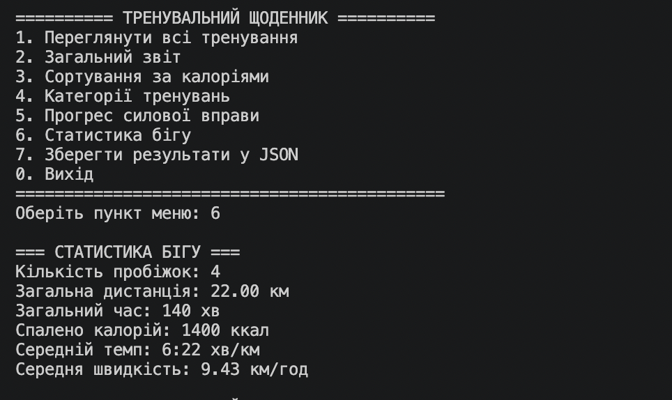
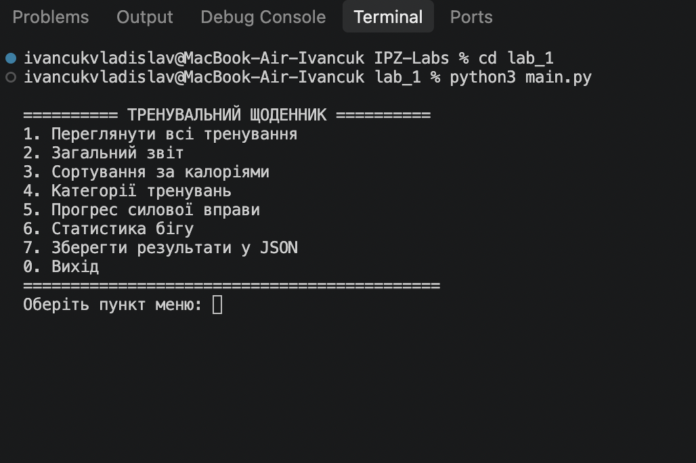
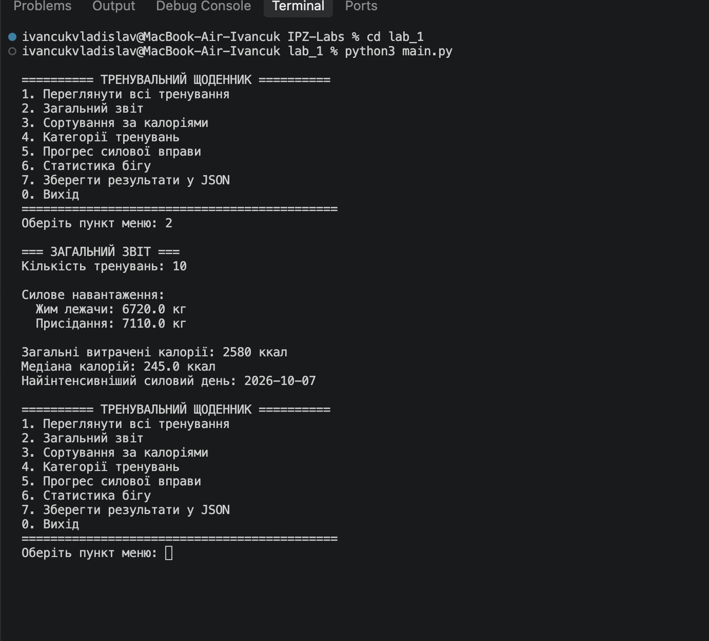
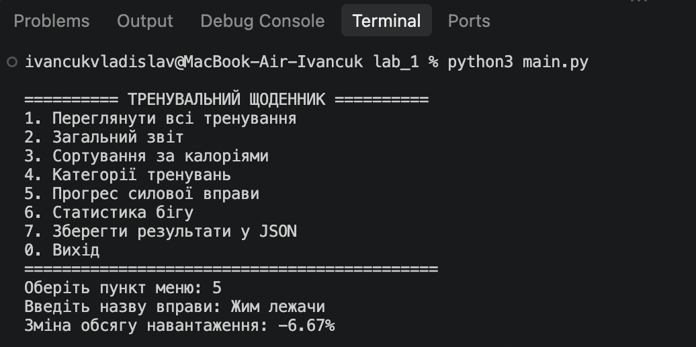
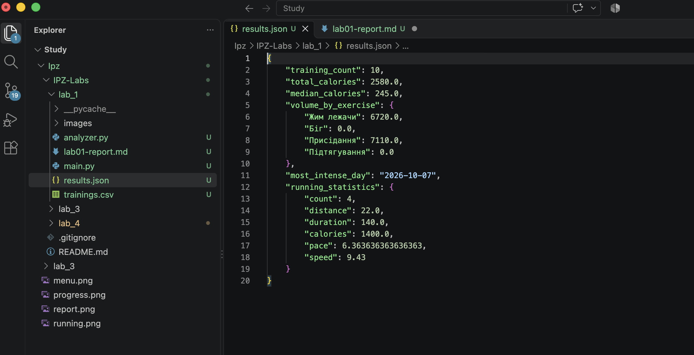

# Звіт до лабораторної роботи №1

**Тема:** Основи Python: обробка та аналіз даних  
**Варіант:** №9 — Тренувальний щоденник  
**Виконав:** Іванчук Владислав Сергійович 
**Група:** ІПЗ-21

## Мета роботи
Навчитися зчитувати табличні дані з CSV, представляти їх списком словників, створювати функції аналізу, обробляти помилки, реалізовувати консольне меню та експортувати результати у JSON.

## Постановка завдання
Розробити програму аналізу тренувань. Дані містять дату, вид вправи, підходи, повторення, вагу, тривалість, дистанцію та витрачені калорії. Реалізувати аналіз силового навантаження, прогресу вправ, статистику бігу, сортування, категоризацію та збереження результатів.

## Структура проєкту
- `main.py` — зчитування CSV, перевірка даних, консольне меню, експорт JSON.
- `analyzer.py` — окремі функції розрахунків.
- `trainings.csv` — початкові дані (10 записів).
- `results.json` — результат експорту, створюється програмою.
- `images/` — скріншоти запуску та результатів.

## Опис алгоритму
1. Програма відкриває `trainings.csv` за допомогою `csv.DictReader`.
2. Перетворює числові поля на `int` або `float`, перевіряє дату та невід'ємність показників. Помилкові рядки пропускає з повідомленням.
3. У циклі показує меню та виконує обрану користувачем операцію.
4. Силове навантаження обчислюється за формулою `підходи × повторення × вага` (кг сумарно піднятої ваги).
5. Прогрес вправи — відсоткова зміна обсягу між першим та останнім записом вправи.
6. Для бігу підсумовуються дистанція, час і калорії; середній темп дорівнює `загальний час / загальна дистанція`, а швидкість — `дистанція / (час / 60)`.
7. Підсумкові показники зберігаються у JSON.

## Результати тестування
Для демонстраційного набору з 10 записів розраховані такі показники (статистику бігу підтверджено запуском):

| Показник | Значення |
|---|---:|
| Кількість тренувань | 10 |
| Загальна кількість калорій | 2580 ккал |
| Кількість пробіжок | 4 |
| Загальна дистанція бігу | 22 км |
| Загальний час бігу | 140 хв |
| Калорії під час бігу | 1400 ккал |
| Середній темп бігу | 6:22 хв/км |
| Середня швидкість | 9,43 км/год |
| Найінтенсивніший силовий день | 2026-10-07 |
| Зміна обсягу вправи «Жим лежачи» | −6,67% |

**Примітка:** наведені результати розраховані за тестовими даними. Інші показники слід остаточно звірити з виводом пунктів меню 2 і 5 після виправлення CSV. Калорії — умовні значення з CSV, не фізіологічні вимірювання.

## Скріншоти та перевірка роботи

На скріншоті нижче показано фактичний результат виконання пункту 6 «Статистика бігу»: 4 пробіжки, 22 км, 140 хв, 1400 ккал, темп 6:22 хв/км та швидкість 9,43 км/год.

### Головне меню

### Загальний звіт

### Прогрес силової вправи

### Статистика бігу

### Збереження результатів

**Перевірка обробки помилок.** Під час першого запуску програма виявила неповний рядок CSV, повідомила номер рядка та продовжила роботу. Після виправлення запису з підтягуваннями повторний запуск статистики бігу пройшов без повідомлень про помилки.

## Відповіді на контрольні запитання

### 1. Чим списки (`list`) відрізняються від словників (`dict`) і чому список словників зручний для представлення табличних даних?
Список — впорядкована колекція, доступ до елементів якої здійснюється за індексом. Словник зберігає пари «ключ — значення», тому до полів можна звертатися за назвою. Список словників зручний для таблиці: кожен словник є рядком, а ключі відповідають назвам стовпців.

### 2. У чому переваги виділення коду в окремі функції замість написання одного суцільного скрипту?
Функції роблять програму зрозумілішою, дають змогу повторно використовувати логіку, незалежно тестувати обчислення та швидше виправляти помилки.

### 3. Для чого потрібні модулі в Python і як здійснюється імпорт функцій з іншого файлу?
Модулі об'єднують пов'язаний код в окремих файлах. Наприклад, `import analyzer` підключає файл `analyzer.py`, а виклик `analyzer.running_statistics(trainings)` використовує функцію з цього модуля. Також можна імпортувати конкретну функцію через `from analyzer import running_statistics`.

### 4. Які проблеми можуть виникнути при обробці «реальних» даних з файлу і як їх можна виявити та обробити?
Можливі відсутні файли, неправильні назви стовпців, порожні поля, некоректні числа й дати, від'ємні значення та помилки кодування. Для обробки застосовують `try/except`, перевірку заголовків CSV, перетворення типів та перевірку допустимих діапазонів. Помилкові рядки можна пропускати з повідомленням про номер рядка.

### 5. У чому різниця між форматами CSV та JSON і коли доцільно використовувати кожен із них?
CSV зберігає табличні дані у вигляді рядків і стовпців, простий для електронних таблиць та імпорту. JSON підтримує вкладені об'єкти, масиви та різні типи значень, тому зручний для структурованих результатів аналізу, налаштувань і обміну даними між програмами.

## Висновок
У лабораторній роботі розроблено консольну програму «Тренувальний щоденник» на Python. Реалізовано читання CSV, перевірку даних, аналіз силових тренувань і бігу, сортування, категоризацію та експорт JSON. Використання окремого модуля для обчислень покращує структуру та можливість розширення програми.
