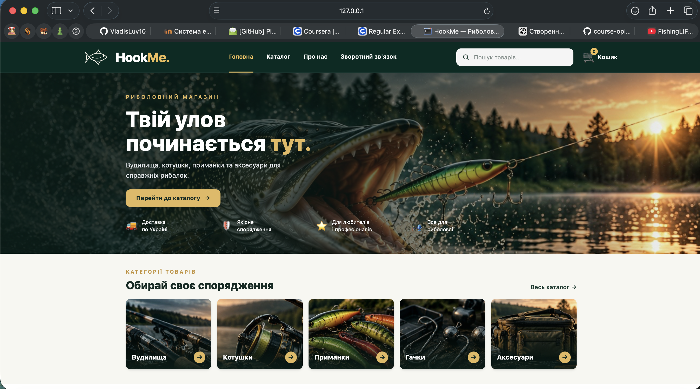
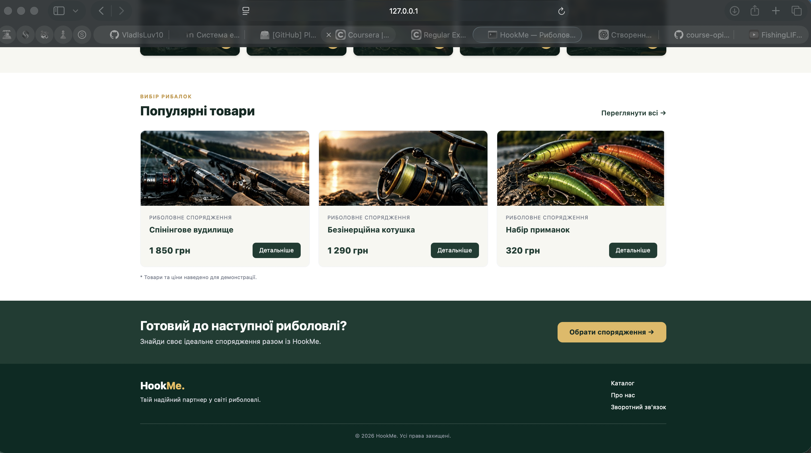
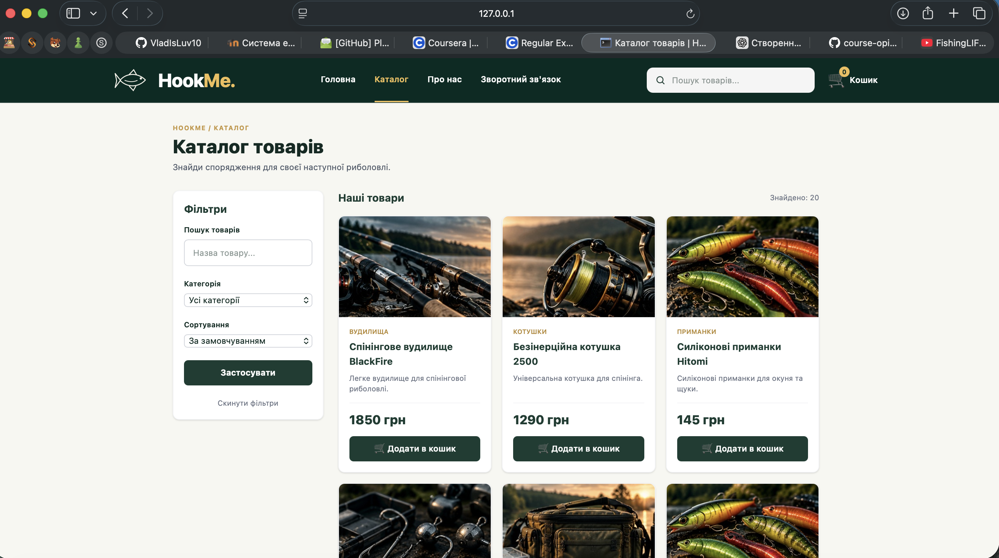
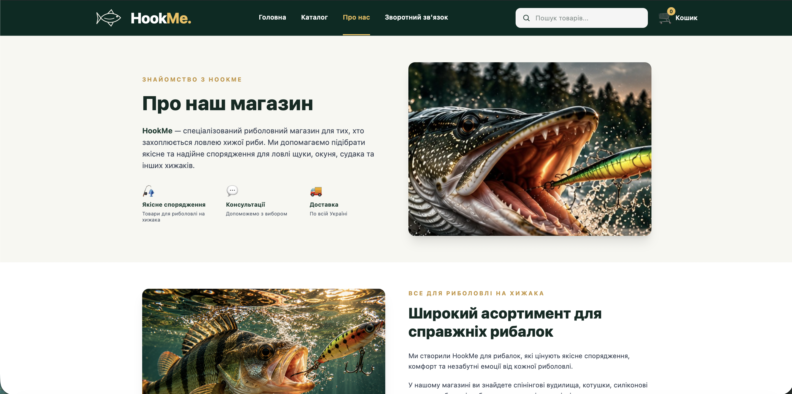
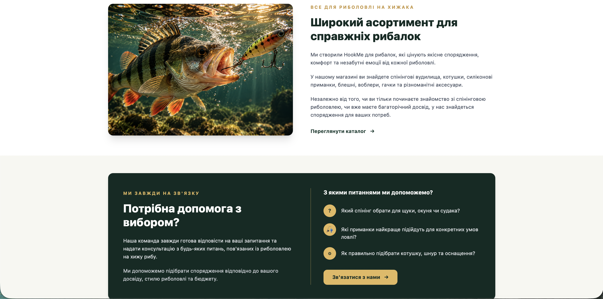
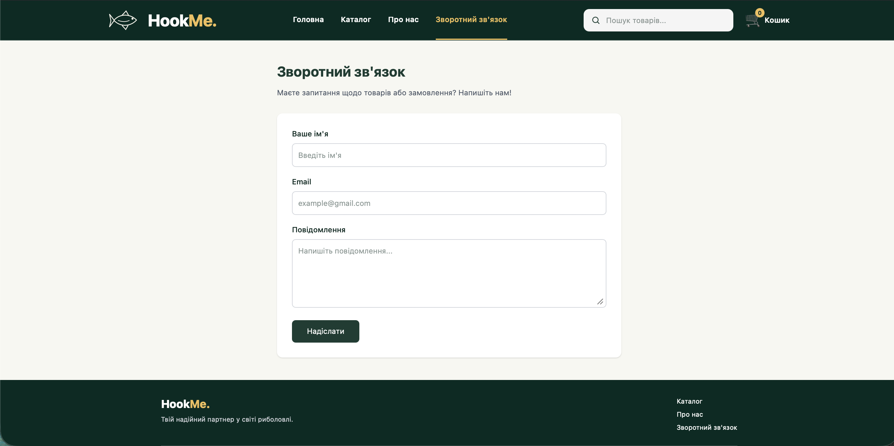
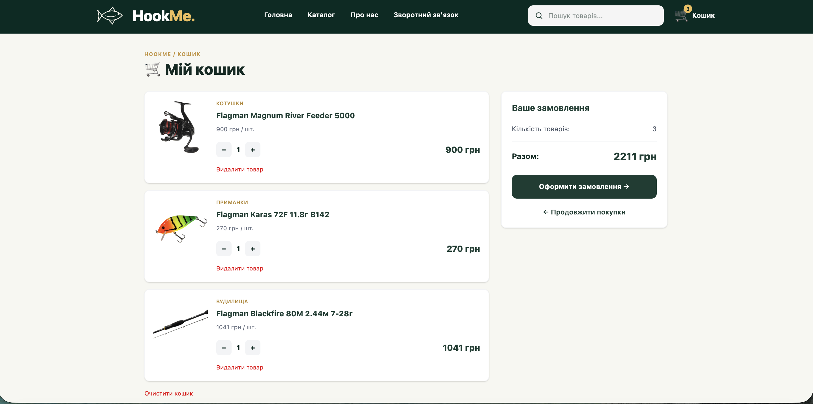

# Звіт до лабораторної роботи №3

**Тема:** Розробка вебінтерфейсу інтернет-магазину HookMe

**Виконав:** Іванчук Владислав Сергійович
**Група:** ІПЗ-21
**Дата:** 12.10.2026

## 1. Мета роботи

Створити вебсайт інтернет-магазину риболовного спорядження,
використовуючи Flask, HTML, шаблони Jinja2 та Tailwind CSS. Розробити
зручний інтерфейс, навігацію між сторінками, каталог товарів, кошик і
форми для користувачів.

## 2. Використані технології

-   **Python та Flask** --- запуск вебзастосунку, маршрути та обробка
    запитів.
-   **HTML і Jinja2** --- створення сторінок і використання спільного
    шаблону.
-   **Tailwind CSS** --- оформлення та адаптація сторінок до різних
    екранів.
-   **Visual Studio Code** --- написання й редагування коду.

## 3. Опис виконаної роботи

Під час виконання лабораторної роботи створено навчальний
інтернет-магазин **HookMe**, орієнтований на спорядження для риболовлі
на хижу рибу.

Розроблено такі сторінки:

1.  **Головна** --- банер магазину, переваги, категорії товарів і блок
    популярних товарів.
2.  **Каталог** --- картки товарів із фотографіями, назвами, цінами та
    кнопками додавання до кошика.
3.  **Кошик** --- перегляд вибраних товарів, зміна кількості та
    підрахунок загальної вартості.
4.  **Оформлення замовлення** --- форма введення контактних даних
    покупця.
5.  **Про нас** --- інформація про магазин, його спеціалізацію та
    консультації.
6.  **Контакти** --- форма для звернень відвідувачів.
7.  **Адміністративна панель** --- інтерфейс для перегляду повідомлень і
    замовлень.

Для сайту обрано темно-зелену та золотисту кольорову гаму. Додано
тематичні зображення риболовного спорядження, щуки й окуня. Завдяки
класам Tailwind CSS сторінки пристосовані до перегляду на комп'ютері й
телефоні.

## 4. Основні можливості вебсайту

У каталозі реалізовано **пошук за назвою**, **вибір категорії** та
**сортування за ціною**. З головної сторінки можна одразу перейти до
потрібної категорії.

Приклад посилання на категорію в шаблоні Jinja2:

``` html
<a href="{{ url_for('catalog', category=name) }}">
```

Для кошика реалізовано додавання товарів, зміну кількості, видалення
позицій та відображення підсумкової суми. Для покупців створено форми
оформлення замовлення та зворотного зв'язку.

Сторінки об'єднані спільним шаблоном `base.html`, що дозволяє
використовувати однакові шапку, навігацію й оформлення на всьому сайті.

## 5. Перевірка роботи

Під час тестування перевірено:

-   перехід між сторінками через меню;
-   відкриття каталогу за вибраною категорією;
-   пошук і сортування товарів;
-   додавання товарів до кошика та зміну їх кількості;
-   відображення форм замовлення і зворотного зв'язку;
-   коректне завантаження зображень на сторінці «Про нас».

## 6. Результат роботи


### 6.1. Головна сторінка (Home)

На головній сторінці інтернет-магазину HookMe
розміщено головний банер, навігаційне меню
та інформацію про магазин.



Нижче представлені категорії риболовного
спорядження та блок популярних товарів.



### 6.2. Каталог товарів

Розроблено каталог із картками товарів,
які містять фотографії, назви та ціни.
Передбачено пошук, фільтрацію за категоріями
та сортування товарів за ціною.



### 6.3. Сторінка «Про нас»

Створено сторінку з інформацією про магазин HookMe,
його спеціалізацію на спорядженні для ловлі
хижої риби та основні напрямки діяльності.



Додатково представлено інформацію про асортимент
магазину та можливість отримання консультацій
щодо вибору риболовного спорядження.



### 6.4. Зворотний зв'язок

Розроблено сторінку контактів із формою,
через яку користувач може надіслати
запитання або звернення до команди магазину.



### 6.5. Кошик покупця

Реалізовано сторінку кошика, де користувач
може переглядати вибрані товари,
змінювати їх кількість, видаляти позиції
та бачити загальну вартість замовлення.



## 7. Висновок

У ході лабораторної роботи створено вебінтерфейс інтернет-магазину
**HookMe**. Було закріплено навички розробки сторінок за допомогою HTML,
Flask, Jinja2 та Tailwind CSS, налаштування навігації, оформлення
каталогу, кошика та форм користувача.

У результаті отримано функціональний і візуально цілісний вебсайт.
Детальну реалізацію бази даних, SQL-запитів та зберігання інформації
буде розглянуто в лабораторній роботі №4.

## 8. Відповіді на контрольні запитання

### 1. Що таке вебфреймворк і чому Flask називають мікрофреймворком?

Вебфреймворк — це набір інструментів для створення вебзастосунків. Він спрощує обробку HTTP-запитів, маршрутизацію та формування сторінок.

Flask називають **мікрофреймворком**, оскільки він містить лише основні компоненти та не нав'язує складної структури проєкту. Додаткові можливості можна підключати за потреби.

### 2. Як у Flask створюється маршрут і що робить декоратор `@app.route`?

Маршрут пов'язує URL-адресу з функцією Python. Декоратор `@app.route` вказує Flask, яку функцію виконати під час звернення до певної адреси.

```python
@app.route("/")
def home():
    return render_template("home.html")
```

У прикладі функція `home()` відповідає за головну сторінку сайту.

### 3. Як передати параметр в адресі сторінки (наприклад, `/user/<username>`)?

Параметр записують у маршруті в кутових дужках, а Flask передає його значення аргументом функції.

```python
@app.route("/user/<username>")
def user(username):
    return f"Вітаю, {username}!"
```

Наприклад, адреса `/user/Vlad` поверне текст «Вітаю, Vlad!». Для числових параметрів можна вказати тип: `<int:product_id>`.

### 4. Що таке шаблонізатор Jinja2 і навіщо він потрібен?

**Jinja2** — це шаблонізатор, який дозволяє вставляти дані Python в HTML, а також використовувати цикли та умови. Завдяки цьому не потрібно створювати окрему HTML-сторінку для кожного товару.

```html
<h2>{{ product.name }}</h2>
<p>{{ product.price }} грн</p>
```

У HookMe Jinja2 використовується, зокрема, для відображення карток товарів у каталозі.

### 5. Як працює наслідування шаблонів (`extends`, `block`)? Яку проблему воно вирішує?

Наслідування дозволяє використовувати спільний шаблон для кількох сторінок. У файлі `base.html` розміщують спільні елементи, наприклад шапку та навігацію. Інші сторінки підключають його через `extends` і заповнюють визначені блоки.

```html



    <h1>Каталог товарів</h1>

```

Це усуває дублювання HTML-коду й дозволяє змінювати спільне оформлення в одному місці.

### 6. Що робить функція `render_template` і де Flask шукає шаблони?

Функція `render_template()` знаходить HTML-шаблон, обробляє його за допомогою Jinja2 та повертає готову сторінку. За замовчуванням Flask шукає шаблони в папці **`templates`**.

```python
return render_template("catalog.html", products=products)
```

У цьому прикладі шаблону `catalog.html` передається список товарів `products`.

### 7. Навіщо створювати віртуальне середовище та файл `requirements.txt`?

**Віртуальне середовище** ізолює бібліотеки одного Python-проєкту від інших проєктів і системних пакетів. Це допомагає уникнути конфліктів версій.

Файл **`requirements.txt`** містить перелік залежностей, необхідних для запуску програми. Встановити їх можна командою:

```bash
pip install -r requirements.txt
```

Це полегшує запуск проєкту на іншому комп'ютері.

### 8. Що таке адаптивна верстка і як її забезпечують засобами Tailwind CSS?

**Адаптивна верстка** — це підлаштування розміщення та розмірів елементів сторінки до різних екранів: телефона, планшета чи комп'ютера.

У Tailwind CSS для цього використовують префікси `sm:`, `md:`, `lg:` та інші.

```html
<div class="grid grid-cols-1 md:grid-cols-2 lg:grid-cols-3">
```

У прикладі на малих екранах буде один стовпець, починаючи з `md` — два, а з `lg` — три. У HookMe такий підхід використовується для адаптивного розміщення елементів сторінок.
