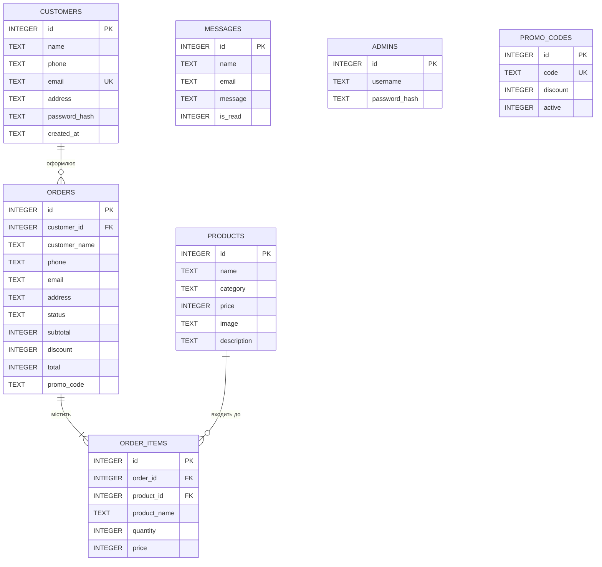
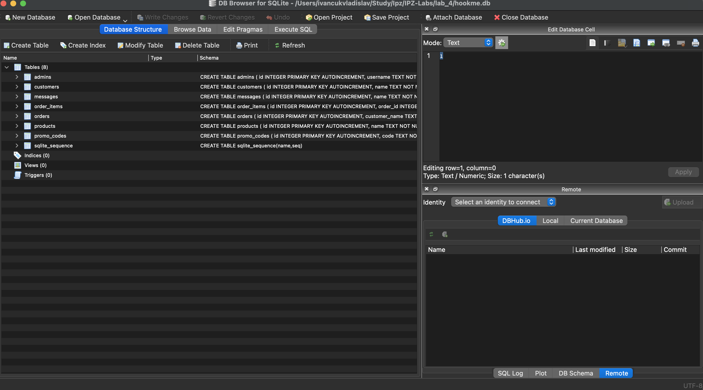
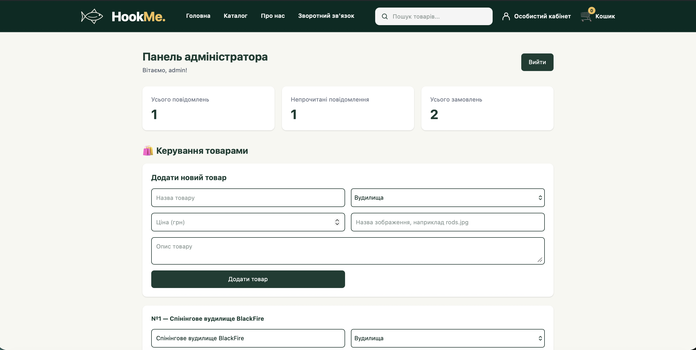
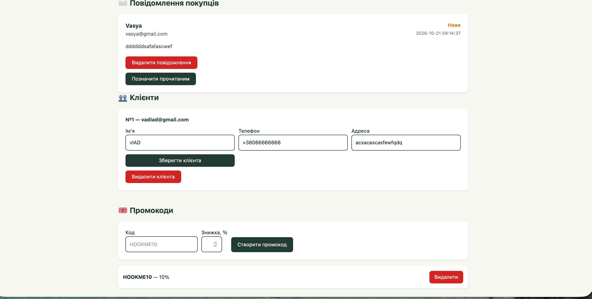
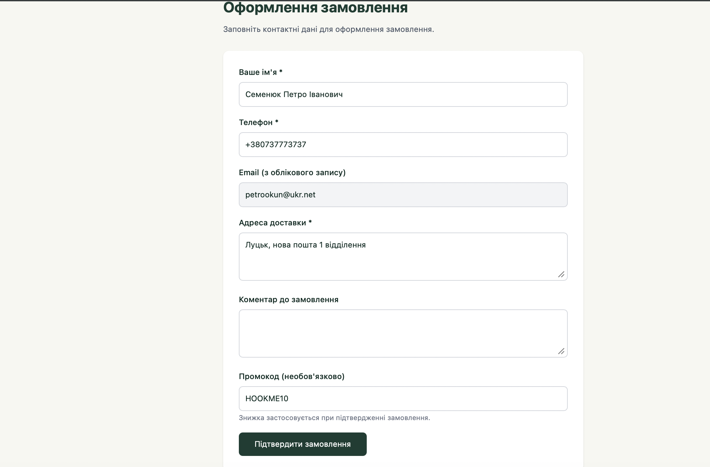
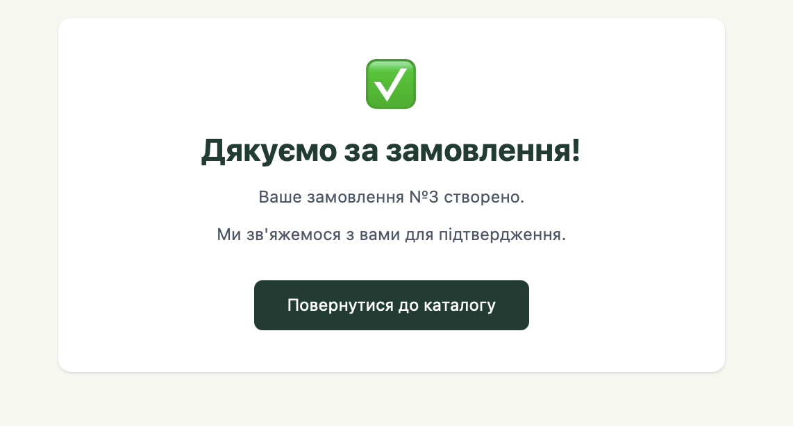
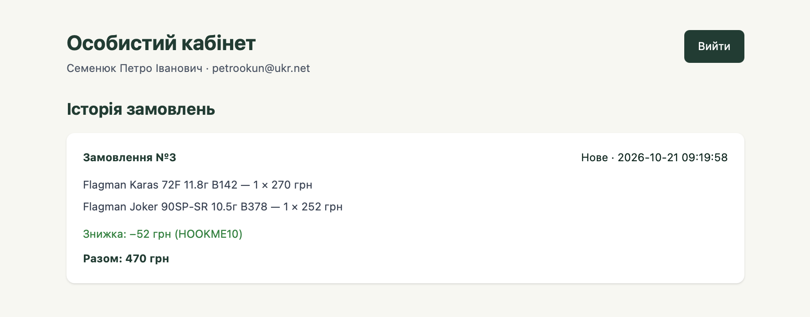

# Звіт до лабораторної роботи №4

**Тема:** Реалізація бази даних для вебпроєкту  
**Проєкт:** HookMe — інтернет-магазин рибальських товарів  

**Виконав:**  Іванчук Владислав Сергійович

**Група:** ІПЗ-21 

**Репозиторій:** https://github.com/VladIsLuv10/IPZ-Labs  

## 1. Мета роботи

Набути практичних навичок проєктування та реалізації реляційної бази даних у вебзастосунку, створення таблиць і зв'язків між ними, виконання CRUD-операцій, а також інтеграції SQLite з Flask.

## 2. Використані технології

- **Python** — серверна логіка.
- **Flask** — маршрути вебзастосунку, обробка форм і сесій.
- **SQLite** (`hookme.db`) — зберігання даних.
- **HTML, Jinja2, Tailwind CSS** — інтерфейс користувача та адміністратора.
- **Visual Studio Code** — розробка.
- **Git та GitHub** — контроль версій.
- **DB Browser for SQLite** — перегляд і редагування структури БД.

## 3. Предметна область і структура проєкту

HookMe — вебмагазин, у якому покупці переглядають каталог, шукають товари, додають їх до кошика, реєструються, оформлюють замовлення з можливістю застосування промокоду та переглядають історію покупок. Адміністратор керує товарами, замовленнями, повідомленнями, клієнтами та промокодами.

Основні файли:

```text
lab_4/
├── app.py                  # Маршрути Flask
├── database.py             # Основні SQL-операції
├── features.py             # Клієнти, промокоди, історія замовлень
├── hookme.db               # База даних SQLite (локально)
├── static/                 # Зображення та інші ресурси
└── templates/              # HTML-шаблони
    ├── base.html
    ├── home.html
    ├── catalog.html
    ├── cart.html
    ├── checkout.html
    ├── admin.html
    ├── customer_register.html
    ├── customer_login.html
    └── customer_account.html
```

## 4. Структура бази даних

У застосунку використовуються такі таблиці:

| Таблиця | Призначення | Основні поля |
|---|---|---|
| `products` | Каталог товарів | `id`, `name`, `category`, `price`, `image`, `description` |
| `messages` | Повідомлення зі зворотного зв'язку | `id`, `name`, `email`, `message`, `is_read`, `created_at` |
| `admins` | Облікові записи адміністраторів | `id`, `username`, `password_hash` |
| `orders` | Замовлення та їхні статуси | `id`, `customer_name`, `phone`, `email`, `address`, `comment`, `total`, `status`, `customer_id`, `subtotal`, `discount`, `promo_code` |
| `order_items` | Позиції замовлень | `id`, `order_id`, `product_id`, `product_name`, `quantity`, `price` |
| `customers` | Зареєстровані клієнти | `id`, `name`, `phone`, `email`, `address`, `password_hash`, `created_at` |
| `promo_codes` | Промокоди | `id`, `code`, `discount`, `active` |

**Первинні ключі:** `id` у кожній таблиці. **Зовнішні ключі:** `order_items.order_id` посилається на `orders.id`, `order_items.product_id` — на `products.id`, `orders.customer_id` — на `customers.id`. Таблиця `order_items` реалізує зв'язок «багато-до-багатьох» між замовленнями й товарами. У `orders.promo_code` зберігається текст використаного коду; це не зовнішній ключ.

### ER-діаграма



*Примітка: на схемі показано основні поля. `messages`, `admins` і `promo_codes` не мають зовнішніх ключів до інших таблиць у поточній реалізації. У старих замовлень `customer_id` може бути `NULL`.*

## 5. Хід виконання роботи

### 5.1. Рівень 1 — базова робота з базою даних

Створено базу даних `hookme.db`. Для зв'язку з SQLite реалізовано функцію `get_connection()` у `database.py`, яка встановлює `row_factory = sqlite3.Row` та активує перевірку зовнішніх ключів через `PRAGMA foreign_keys = ON`.

Реалізовано:

1. Збереження повідомлень із форми зворотного зв'язку в таблиці `messages` (аналог `feedback` у завданні).
2. Перегляд повідомлень, позначення їх прочитаними та видалення в адмін-панелі.
3. Зберігання товарів у `products`, їх додавання, редагування та видалення.
4. Збереження замовлень у `orders` і позицій замовлень у `order_items`.
5. Перемикання статусів замовлень через адмін-панель.
6. Пошук, фільтрацію та сортування каталогу товарів.

Приклад параметризованого SQL-запиту з проєкту:

```python
def get_product(product_id):
    with get_connection() as db:
        row = db.execute(
            "SELECT * FROM products WHERE id = ?",
            (product_id,)
        ).fetchone()
        return dict(row) if row else None
```

### 5.2. Рівень 2 — таблиця клієнтів

Створено таблицю `customers` з іменем, контактними даними, email та хешем пароля. У вебзастосунку реалізовано реєстрацію й авторизацію клієнта, а в адмін-панелі — перегляд, редагування та видалення записів клієнтів. Під час оформлення замовлення зберігається зв'язок із авторизованим клієнтом через `orders.customer_id`.

Паролі зберігаються не у відкритому вигляді, а як хеші за допомогою функцій Werkzeug.

### 5.3. Рівень 3 — дві додаткові функції

**Функція 1. Особистий кабінет та історія замовлень.** Клієнт може зареєструватися (`/register`), увійти (`/login`) і переглянути власні замовлення (`/account`). Історія вибирається за ідентифікатором клієнта, який зберігається в сесії. У верхнє меню додано посилання «Особистий кабінет» з іконкою.

**Функція 2. Система промокодів.** Адміністратор створює промокоди з відсотком знижки. Клієнт вводить код під час оформлення замовлення. Сервер перевіряє його в таблиці `promo_codes`, обчислює знижку та записує початкову суму, суму знижки й остаточну вартість до `orders`.

Наприклад, для товарів на **1000 грн** із промокодом **10%** сума знижки становить **100 грн**, а до сплати — **900 грн**.

## 6. Приклади SQL-запитів

**Отримання всіх товарів:**

```sql
SELECT * FROM products ORDER BY id;
```

**Отримання замовлень із даними зареєстрованих клієнтів:**

```sql
SELECT o.id, c.name, o.total, o.status
FROM orders AS o
LEFT JOIN customers AS c ON c.id = o.customer_id
ORDER BY o.id DESC;
```

**Отримання товарів конкретного замовлення:**

```sql
SELECT product_name, quantity, price, quantity * price AS amount
FROM order_items
WHERE order_id = 1;
```

**Перегляд активних промокодів:**

```sql
SELECT code, discount
FROM promo_codes
WHERE active = 1;
```

**Зміна статусу замовлення:**

```sql
UPDATE orders
SET status = 'Підтверджено'
WHERE id = 1;
```

*Ідентифікатори `1` у прикладах умовні; для перевірки слід використовувати фактичні ID з бази даних.*

## 7. Тестування

Під час ручної перевірки було підтверджено працездатність сайту після інтеграції нових функцій. Перевірялися реєстрація та вхід клієнта, особистий кабінет, керування товарами й повідомленнями, створення промокоду, оформлення замовлення зі знижкою та відображення історії замовлень. Для підтвердження результатів у звіті необхідно додати власні скриншоти.

### Скриншоти

> Зробіть скриншоти та збережіть їх у `lab-reports/screenshots/`. Після цього наведені посилання почнуть відображати зображення у Markdown.

**Рисунок 1. Таблиці бази даних у DB Browser for SQLite**



**Рисунок 2. Адмін-панель — керування товарами та замовленнями**



**Рисунок 3. Адмін-панель — клієнти та промокоди**



**Рисунок 4. Оформлення замовлення з промокодом**





**Рисунок 5. Особистий кабінет та історія замовлень**



## 8. Труднощі та способи їх вирішення

Під час оновлення шаблонів виникла помилка `jinja2.exceptions.TemplateNotFound: home.html`. Її причиною була відсутність попереднього шаблону головної сторінки після заміни папки `templates`. Проблему усунено відновленням відсутніх HTML-файлів із попередньої версії проєкту без перезапису нових шаблонів.

Під час розширення бази даних важливо було зберегти наявні товари та замовлення. Для цього нові таблиці створювалися через `CREATE TABLE IF NOT EXISTS`, а додаткові поля таблиці `orders` — через `ALTER TABLE`, без видалення старої бази.

## 9. Відповіді на контрольні запитання

**1. Що таке база даних і СКБД? Чим вони відрізняються?**  
База даних — організована сукупність взаємопов'язаних даних. СКБД — програмне забезпечення для створення, збереження, пошуку та зміни цих даних. У HookMe база даних зберігається у файлі `hookme.db`, а для роботи з нею використовується SQLite.

**2. Що таке реляційна модель даних? Поясніть поняття таблиці, рядка та стовпця.**  
Реляційна модель подає дані у вигляді таблиць, пов'язаних ключами. Таблиця містить записи певного типу, рядок — один запис, а стовпець — окрему властивість. Наприклад, у `products` кожен рядок описує товар, а `name` і `price` — його властивості.

**3. Що таке первинний і зовнішній ключі? Наведіть приклади з вашого проєкту.**  
Первинний ключ (`PRIMARY KEY`) унікально визначає запис: наприклад, `products.id`. Зовнішній ключ (`FOREIGN KEY`) пов'язує записи різних таблиць: `order_items.order_id` посилається на `orders.id`, а `orders.customer_id` — на `customers.id`.

**4. Які типи зв'язків між таблицями існують? Як реалізувати зв'язок «багато-до-багатьох» між замовленнями й товарами?**  
Існують зв'язки «один-до-одного», «один-до-багатьох» і «багато-до-багатьох». Останній реалізовано проміжною таблицею `order_items`: одне замовлення може містити багато товарів, а один товар — входити до багатьох замовлень.

**5. Що означає абревіатура CRUD і яким SQL-командам відповідає кожна операція?**  
CRUD — Create (`INSERT`), Read (`SELECT`), Update (`UPDATE`), Delete (`DELETE`). Ці операції застосовуються до товарів, повідомлень та клієнтів у HookMe.

**6. Які переваги та обмеження має SQLite порівняно з клієнт-серверними СКБД?**  
SQLite проста в налаштуванні, не потребує окремого сервера та зберігає дані в одному файлі. Вона зручна для навчальних і невеликих проєктів. Обмеження — менші можливості для високого навантаження з великою кількістю одночасних записів порівняно з PostgreSQL або MySQL.

**7. Що таке SQL-ін'єкція і як параметризовані запити захищають від неї?**  
SQL-ін'єкція — спроба змінити логіку SQL-запиту через введені користувачем дані. Параметризовані запити відокремлюють SQL-код від значень. Наприклад, `SELECT * FROM products WHERE id = ?` передає `id` окремим параметром, тому введене значення не виконується як SQL-код.

**8. Навіщо відкривати й закривати з'єднання з базою даних для кожного запиту та викликати `commit()`?**  
З'єднання відкривають для виконання операцій і закривають після використання, щоб звільняти ресурси та не накопичувати зайві підключення. `commit()` підтверджує транзакцію й зберігає зміни, внесені командами `INSERT`, `UPDATE`, `DELETE`. У Python контекстний менеджер `with connection:` підтверджує або відкочує транзакцію, але сам по собі не гарантує закриття з'єднання; для цього потрібен `close()`.

## 10. Висновок

У ході лабораторної роботи реалізовано базу даних SQLite для інтернет-магазину HookMe та інтегровано її з Flask. Створено взаємопов'язані таблиці, CRUD-операції й адміністративний інтерфейс, а також додано облікові записи клієнтів, історію замовлень і систему промокодів. Отримано практичні навички проєктування реляційної бази даних та організації взаємодії вебзастосунку з нею.
