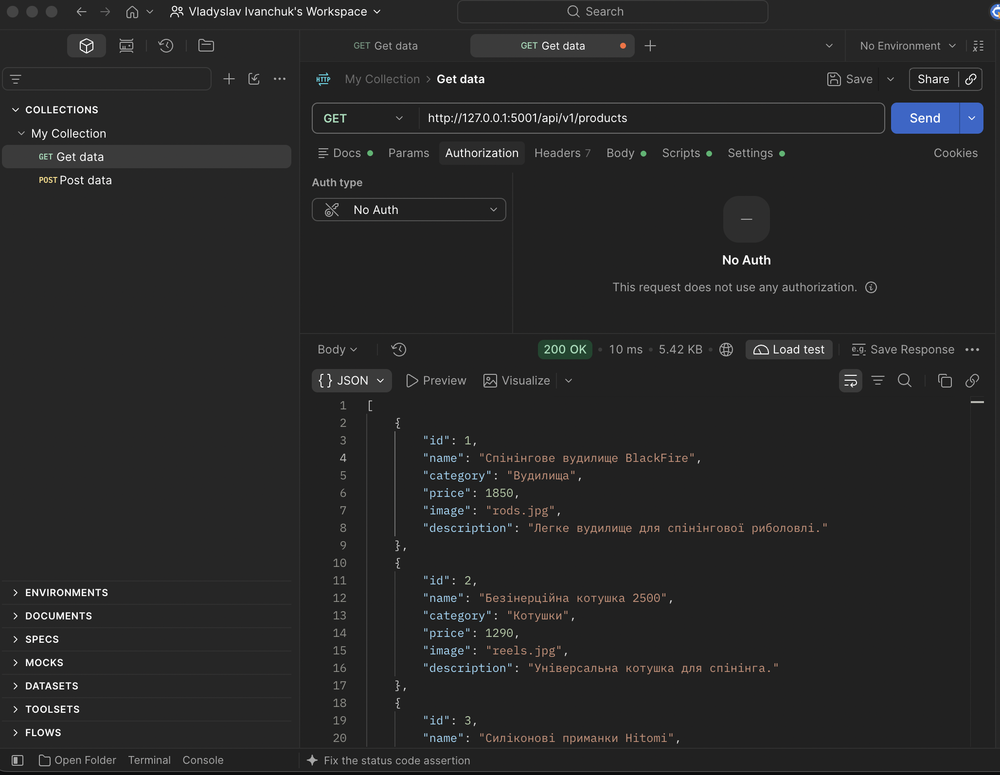
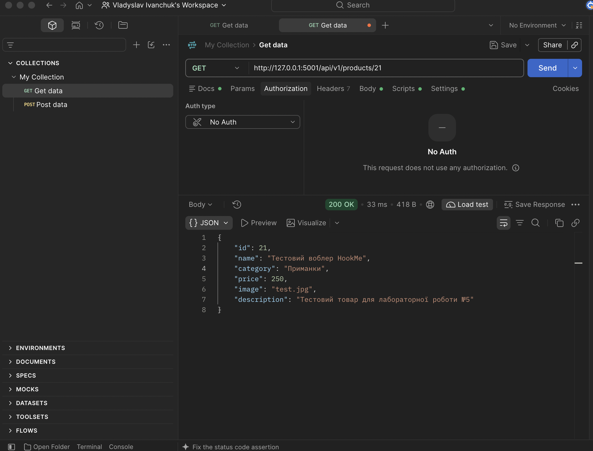
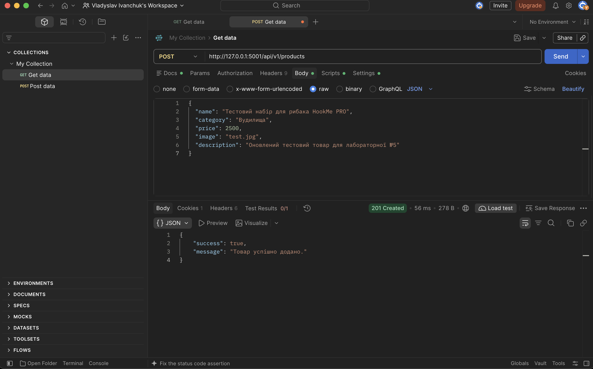
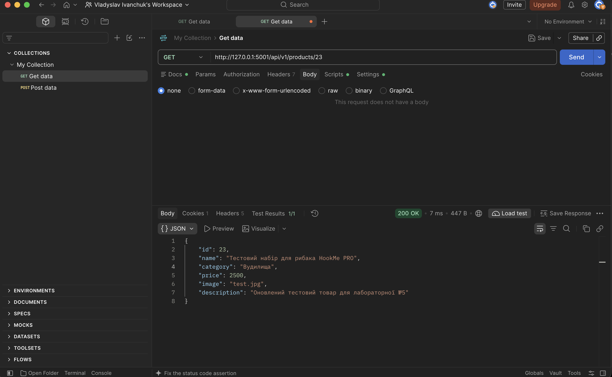
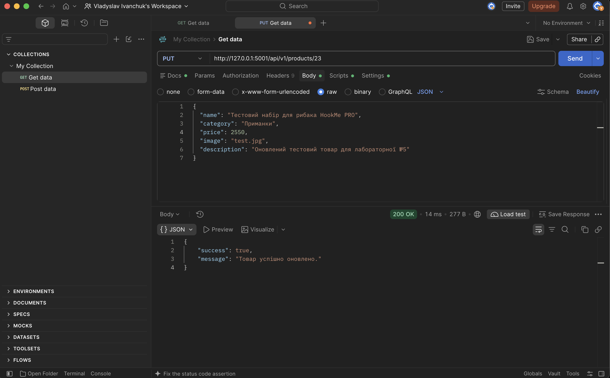
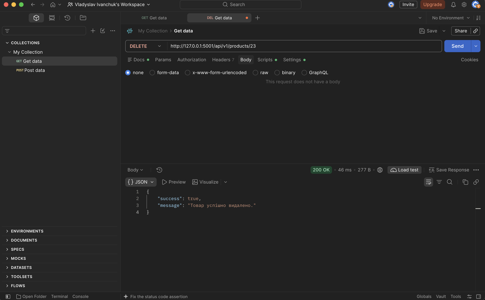
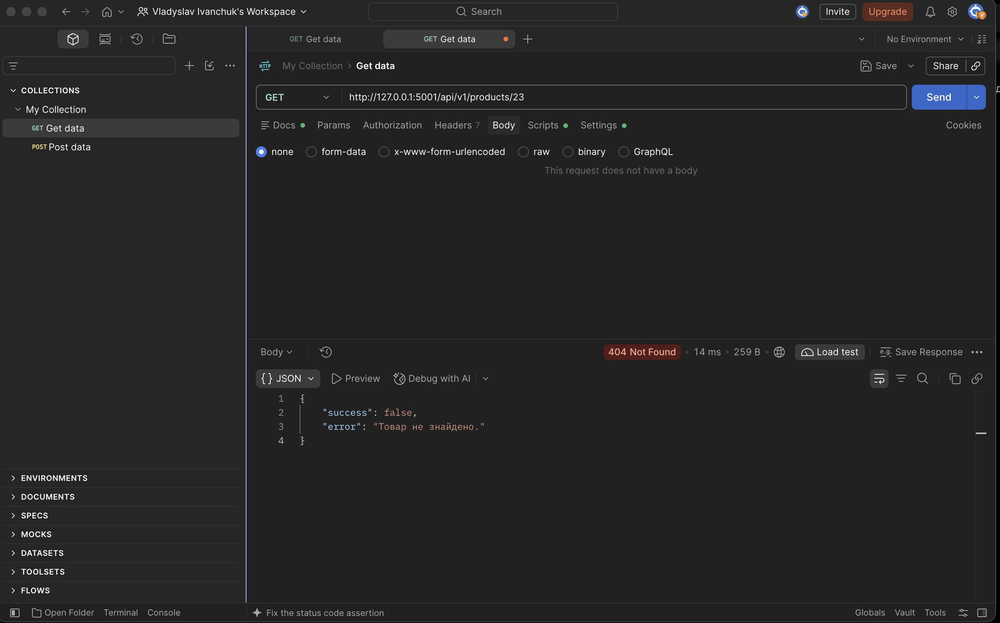
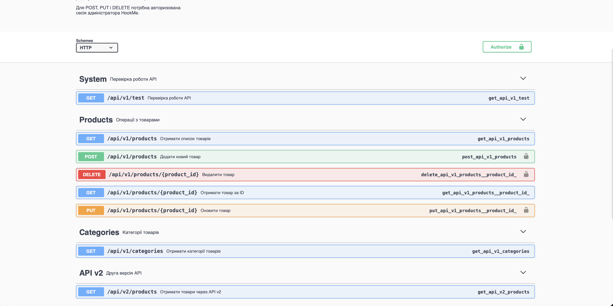

# Звіт до лабораторної роботи №5

**Тема:** Розробка RESTful API та його документування.

**Проєкт:** HookMe — інтернет-магазин рибальських товарів.

**Виконав:**  Іванчук Владислав Сергійович

**Група:** ІПЗ-21 

**Репозиторій:** https://github.com/VladIsLuv10/IPZ-Labs  

**Мета роботи:** Ознайомитися з принципами побудови RESTful API, навчитися створювати HTTP-ендпоінти за допомогою Flask, обробляти JSON-дані, використовувати відповідні HTTP-методи та коди стану, тестувати API через Postman і документувати його за допомогою Swagger.

## 1. Використані технології

- Python — мова програмування.
- Flask — вебфреймворк для створення API.
- SQLite — база даних товарів.
- Postman — тестування HTTP-запитів.
- JSON — формат обміну даними.
- Flasgger та Swagger — документування API.
- Visual Studio Code — середовище розробки.

## 2. Опис виконаної роботи

Для інтернет-магазину HookMe було розроблено RESTful API, яке забезпечує доступ до інформації про товари та дозволяє виконувати основні операції над ними.

API реалізовано в окремому файлі `api.py` за допомогою Flask Blueprint та підключено до основного застосунку `app.py`.

Для роботи з товарами використано функції модуля `database.py`, які взаємодіють із базою даних SQLite.

Реалізовано перевірку вхідних даних, обробку помилок та обмеження доступу до операцій створення, редагування й видалення товарів. Для цих операцій необхідна авторизована сесія адміністратора.

## 3. Реалізовані API-ендпоінти

| HTTP-метод | Маршрут | Призначення |
|---|---|---|
| GET | `/api/v1/test` | Перевірка роботи API |
| GET | `/api/v1/products` | Отримання всіх товарів |
| GET | `/api/v1/products/<id>` | Отримання товару за ID |
| GET | `/api/v1/categories` | Отримання категорій |
| POST | `/api/v1/products` | Створення товару |
| PUT | `/api/v1/products/<id>` | Оновлення товару |
| DELETE | `/api/v1/products/<id>` | Видалення товару |
| GET | `/api/v2/products` | Отримання товарів через другу версію API |

У маршруті отримання списку товарів реалізовано фільтрацію за категорією, пошук за назвою та сортування за ціною.

## 4. Тестування REST API в Postman

### 4.1. Отримання списку товарів

Було виконано GET-запит до `/api/v1/products`. Сервер повернув список товарів у форматі JSON зі статусом **200 OK**.

### 4.2. Отримання товару за ID

За допомогою GET-запиту до `/api/v1/products/21` отримано інформацію про окремий товар. Сервер повернув **200 OK**.

### 4.3. Створення нового товару

Для додавання товару виконано POST-запит до `/api/v1/products`. Дані товару передавалися в тілі запиту у форматі JSON. Після успішного створення сервер повернув **201 Created**.

### 4.4. Перевірка створеного товару

Після додавання нового товару було виконано GET-запит до `/api/v1/products/23`. Сервер повернув **200 OK** та інформацію про створений товар.

### 4.5. Оновлення товару

Для редагування товару виконано PUT-запит до `/api/v1/products/23`. Було змінено дані тестового товару, зокрема його ціну. Сервер повернув **200 OK** та повідомлення про успішне оновлення.

### 4.6. Видалення товару

Для видалення тестового товару виконано DELETE-запит до `/api/v1/products/23`. Сервер повернув **200 OK** та повідомлення про успішне видалення.

### 4.7. Перевірка обробки помилки 404

Після видалення товару було повторно виконано GET-запит за його ID. Сервер повернув **404 Not Found** із JSON-повідомленням про відсутність товару.

## 5. Обробка помилок

У REST API передбачено використання стандартних HTTP-кодів:

| Код | Значення |
|---|---|
| 200 | Запит успішно виконано |
| 201 | Ресурс успішно створено |
| 400 | Некоректні вхідні дані |
| 401 | Необхідна авторизація адміністратора |
| 404 | Ресурс не знайдено |
| 409 | Конфлікт під час видалення товару |
| 415 | Непідтримуваний формат запиту |

Помилки повертаються у форматі JSON, що дозволяє клієнтським застосункам обробляти їх програмно.

## 6. Версіонування API

Для демонстрації версіонування передбачено два маршрути:

- `/api/v1/products` — повертає масив товарів.
- `/api/v2/products` — повертає розширений JSON-об'єкт із версією API, кількістю товарів і масивом даних.

Це демонструє можливість розвитку API без порушення сумісності з клієнтами попередньої версії.

## 7. Документування API

Для документування REST API підготовлено специфікацію Swagger у файлі `swagger.yml`.

Документація описує маршрути API, HTTP-методи, параметри запитів, структури JSON та можливі коди відповідей.

Для відображення інтерактивної документації використовується бібліотека Flasgger. Документація має бути доступна за адресою `/apidocs/` після її підключення до застосунку.

## 8. Висновок

Під час виконання лабораторної роботи було розроблено RESTful API для інтернет-магазину рибальських товарів HookMe за допомогою Python та Flask.

Було реалізовано основні HTTP-методи GET, POST, PUT і DELETE, перевірку вхідних даних, авторизацію адміністратора, обробку помилок і версіонування API.

За допомогою Postman проведено тестування основних операцій. Отримані результати підтвердили коректну роботу створення, отримання, редагування та видалення товарів, а також обробку помилки 404.

У результаті роботи було закріплено практичні навички розробки та тестування вебсервісів на основі REST API.
