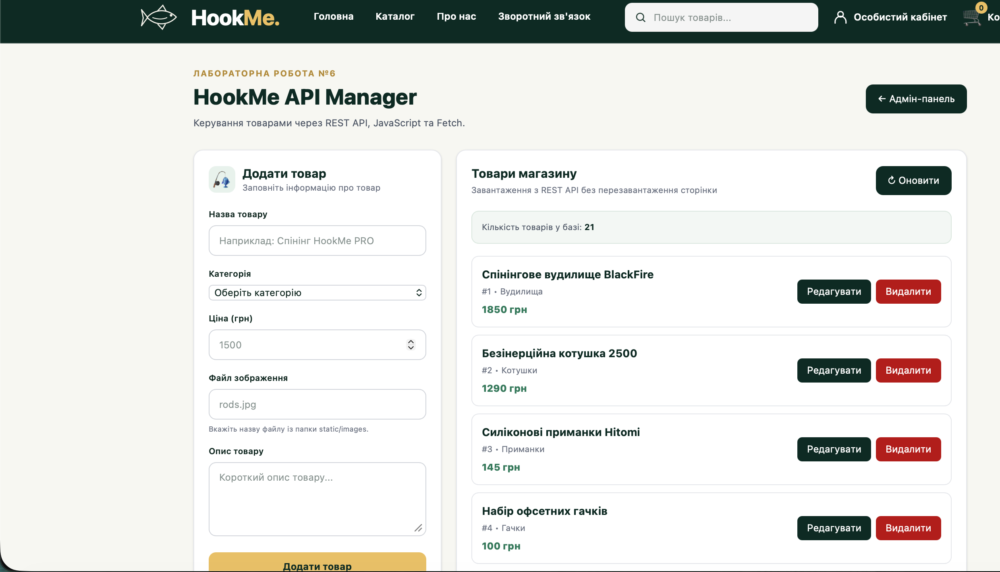
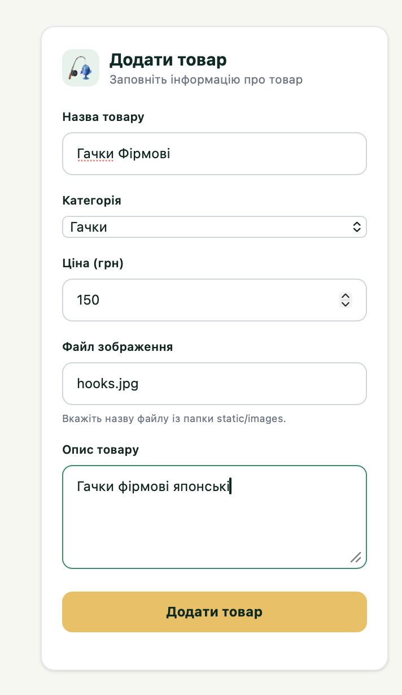
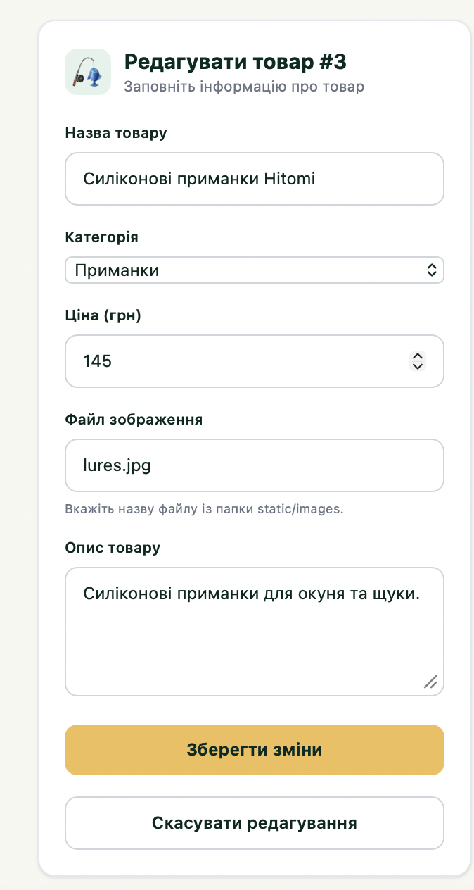
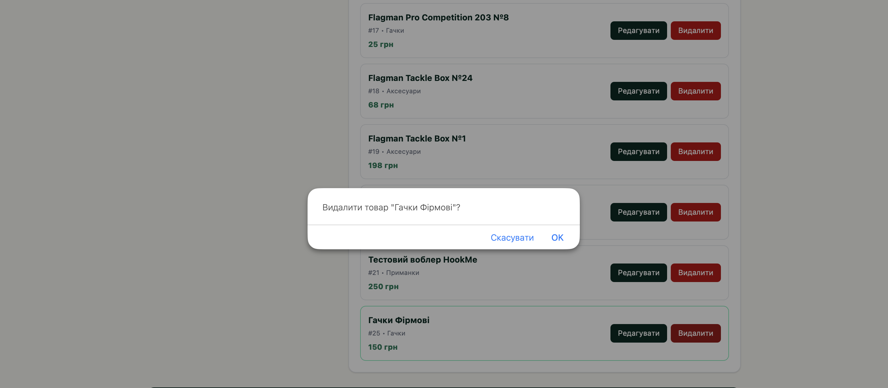

# Звіт до лабораторної роботи №6

**Тема:** Інтеграція клієнтської частини вебзастосунку з REST API за допомогою JavaScript `fetch()`.

**Виконав:** Іванчук Владислав Сергійович  
**Проєкт:** HookMe — інтернет-магазин рибальських товарів.

## 1. Мета роботи

Навчитися використовувати JavaScript `fetch()` для асинхронної взаємодії з REST API, обробляти JSON-відповіді та помилки, реалізувати CRUD-операції без перезавантаження сторінки.

## 2. Використані технології

- Python, Flask — серверна частина.
- JavaScript, Fetch API — HTTP-запити.
- SQLite — збереження товарів.
- HTML, Tailwind CSS — інтерфейс.
- Safari Web Inspector — налагодження.

## 3. Хід виконання роботи

### 3.1. Підготовка проєкту

На основі попередніх лабораторних робіт створено сторінку `/api-demo` для керування товарами HookMe. Використано файли `app.py`, `api.py`, `database.py`, `templates/api-demo.html` та `static/js/api-demo.js`.

### 3.2. Отримання товарів (GET)

Для отримання товарів із маршруту `GET /api/v1/products` використано асинхронний запит:

```javascript
const data = await apiRequest("/api/v1/products");
products = data;
renderProducts();
```

Товари відображаються з назвами, категоріями, цінами та кнопками керування.



### 3.3. Додавання товару (POST)

Дані форми передаються у форматі JSON:

```javascript
await apiRequest("/api/v1/products", {
    method: "POST",
    headers: { "Content-Type": "application/json" },
    body: JSON.stringify(data)
});
```

Після додавання список оновлюється без перезавантаження сторінки.



### 3.4. Редагування товару (PUT)

При виборі товару його дані підставляються у форму. Для збереження змін використовується PUT:

```javascript
await apiRequest(`/api/v1/products/${productId}`, {
    method: "PUT",
    headers: { "Content-Type": "application/json" },
    body: JSON.stringify(data)
});
```



### 3.5. Видалення товару (DELETE)

Перед видаленням користувач підтверджує дію. Після цього надсилається запит:

```javascript
await apiRequest(`/api/v1/products/${product.id}`, {
    method: "DELETE"
});
```



### 3.6. Обробка помилок

Для обробки помилок застосовано `try...catch`:

```javascript
try {
    const data = await apiRequest(API_URL);
    products = data;
    renderProducts();
} catch (error) {
    showNotification(error.message, "error");
}
```

Реалізовано перевірку введених даних і повідомлення про помилки. Під час налагодження виявлено `404 Not Found` для `api-demo.js`. Після розміщення файлу в `static/js/` завантаження товарів запрацювало.


## 4. Результати роботи

Реалізовано отримання (GET), додавання (POST), редагування (PUT) та видалення (DELETE) товарів через REST API. Дані зберігаються в SQLite, а список товарів оновлюється без перезавантаження сторінки. Основні функції перевірено, вони працюють коректно.

## 5. Висновок

Під час виконання лабораторної роботи №6 я навчився використовувати JavaScript `fetch()` для роботи з REST API, виконувати асинхронні HTTP-запити, обробляти JSON та помилки. У проєкті HookMe реалізовано інтерактивне керування товарами.

**Репозиторій:** https://github.com/VladIsLuv10/IPZ-Labs
